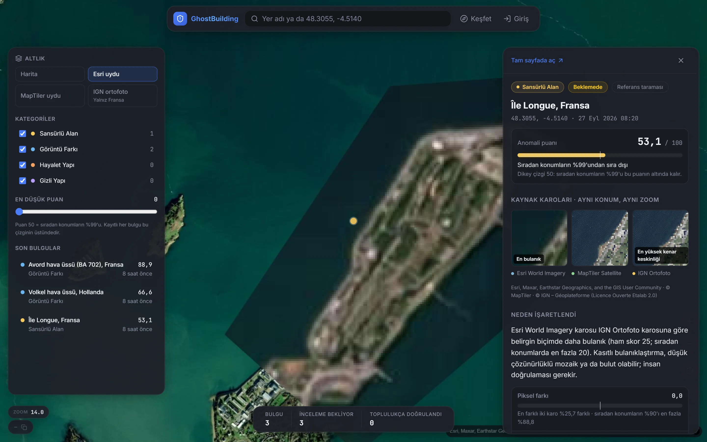
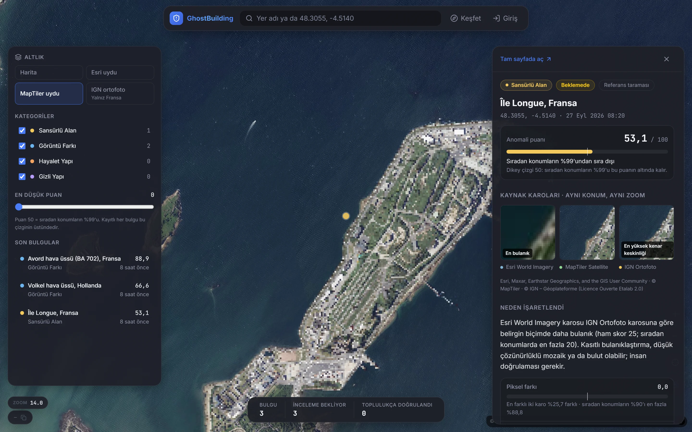
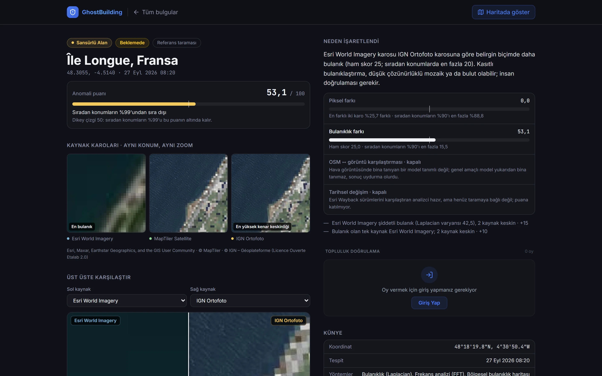
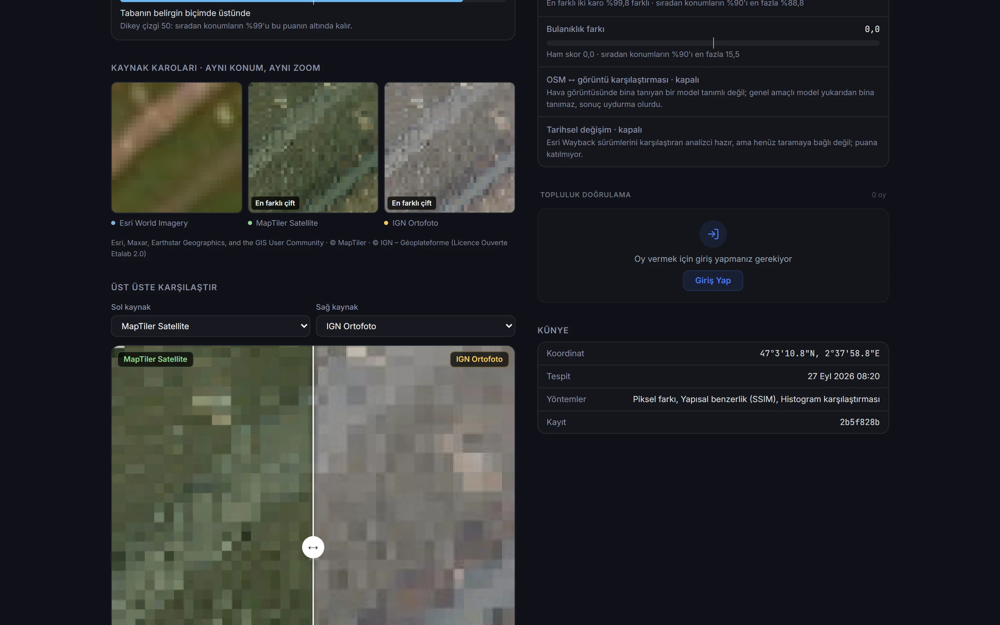
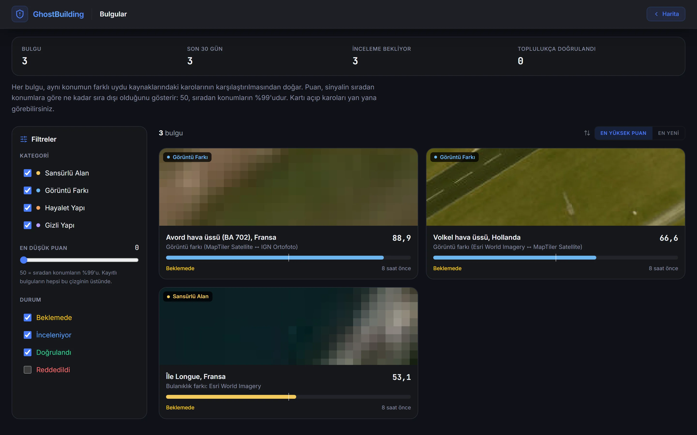

# GhostBuilding

**Aynı konumun farklı uydu kaynaklarındaki karolarını karşılaştırıp sıradan konumlara göre sıra
dışı olan farkları işaretleyen, her bulguyu kanıt karolarıyla gösteren OSINT harita aracı.**

Hassas tesisler uydu görüntülerinde çoğu zaman gizlenir: bir sağlayıcı bölgeyi bulanıklaştırır,
bir başkası mozaikler, üçüncüsü eski bir çekimi gösterir. GhostBuilding bir koordinat için
Esri World Imagery, MapTiler Satellite ve (Fransa'da) IGN ortofoto karolarını aynı zoom'da indirir,
aralarındaki piksel ve keskinlik farkını ölçer, bu farkı **sıradan konumlardan ölçülmüş bir taban
dağılımıyla** kıyaslar. Puan bir "gizli tesis olasılığı" değildir; sinyalin sıradan konumların
yüzde kaçından sıra dışı olduğunu söyler. Her bulgu karoları yan yana, gerekçesi ve eşik değerleriyle
birlikte gösterilir; son kararı topluluk doğrulaması verir.



Île Longue (Fransa'nın nükleer denizaltı üssü) aynı zoom'da iki kaynakta iki farklı yöntemle
gizleniyor: Esri'de bulanık bir yama, MapTiler'da piksel mozaiği.



## Ne yapar

| | |
|---|---|
| **Tarama** | Bir koordinat (ya da ızgara) için tüm uygun kaynaklardan z16 karo indirir. Tarama giriş ister, çünkü her tarama MapTiler kotasından harcar. Celery kuyruğunda çalışır, ilerleme bildirilir. |
| **Görüntü farkı** | Karolar aynı boyuta ölçeklenir; SSIM, mutlak fark ve histogram ayrışmasıyla "en farklı iki kaynak" bulunur. |
| **Sansür (bulanıklık)** | Laplacian varyansı, FFT'de yüksek frekans kaybı ve bölgesel bulanıklık haritasıyla bir kaynağın diğerlerinden belirgin biçimde bulanık olup olmadığı ölçülür. Her kural isabeti gerekçe olarak yazılır ve puan katkısını taşır. |
| **Puanlama** | Ham ölçümler taban dağılımına göre 0–100'e çevrilir: taban p90'a kadar 0, p90→p99 arası 0→50, p99 üstü 50→100. 50 çizgisi "sıradan konumların %99'u" demektir. |
| **Bulgu** | Eşiği geçen sonuç PostGIS'e yazılır; aynı konum yeniden tarandığında kayıt güncellenir (tarama sayısı artar), kopya üretilmez. |
| **Doğrulama** | Kayıtlı kullanıcılar oy verir. 10+ etkin oy ve %75 onayla bulgu doğrulanır, 5+ oy ve %25 altı onayla reddedilir. İsabetli oy güven puanını artırır; güven puanı 55'i geçen kullanıcının oyu iki kat sayılır. |

Kapalı sinyaller gizlenmez, gerekçesiyle listelenir. Esri Wayback sürümlerinden zaman serisi
çıkaran analizci (`TimeSeriesAnalyzer`, aynı görüntüyü döndüren sürümleri eler) yazılı ve test
edilmiş durumda, ama henüz tarama akışına bağlı değil. OSM binaları ile uydu görüntüsünü
karşılaştıran "hayalet bina / gizli yapı" analizi, hava görüntüsünde bina tanıyan ağırlıklar
(`BUILDING_DETECTOR_WEIGHTS`) verilmedikçe kapalıdır. Genel amaçlı bir COCO modeli yukarıdan bina
tanımaz; açık olsaydı sonuç uydurma olurdu.

## Nasıl ölçüldü

Eşikler elle seçilmedi, `backend/scripts/calibrate_diff.py` ile ölçüldü:

| Taban | Konum | Piksel farkı p90 / p99 | Sansür skoru p90 / p99 |
|---|---|---|---|
| Esri + MapTiler | 40 sıradan konum, z16 ([veri](docs/calibration-z16.json)) | %80,1 / %87,6 | 15,5 / 20 |
| Esri + MapTiler + IGN | 20 sıradan Fransız konumu ([veri](docs/calibration-z16-fransa.json)) | %88,8 / %99,0 | 1,5 / 19,1 |

Üç kaynakta ölçü "en farklı çift" olduğu için dağılım yukarı kayar; bu yüzden kaynak sayısına göre
ayrı taban kullanılır. Kalibrasyondan önceki eşikler (%15 / %30) sıradan 40 konumun 39'unu
işaretliyordu.

**Referans taraması** (`backend/scripts/seed_data.py`, [rapor](docs/reference-scan.json)): kamuya
açık kaynaklarda adı geçen 20 askeri/nükleer tesis ve 7 sıradan kontrol konumu aynı motordan
geçirildi. 3 tesis işaretlendi, kontrollerin hiçbiri işaretlenmedi:

| Konum | Bulgu | Puan |
|---|---|---|
| Avord hava üssü (BA 702), Fransa | Görüntü farkı (MapTiler ↔ IGN, %99,8) | 88,9 |
| Volkel hava üssü, Hollanda | Görüntü farkı (Esri ↔ MapTiler, %91,7) | 66,6 |
| Île Longue, Fransa | Sansürlü alan (Esri bulanık, 2 kaynak keskin) | 53,1 |

Area 51, Pine Gap, Dimona gibi tesisler işaretlenmedi: bu kaynaklarda o konumlar gizlenmiyor ya da
fark sıradan konumların içinde kalıyor. Demo verisi yalnız bu taramadan gelir; elle yazılmış skor yoktur.

## Mimari

```
            ┌──────────── Next.js 16 (MapLibre) ─────────────┐
            │ harita · bulgu paneli · keşfet · doğrulama     │
            └──────────────────────┬─────────────────────────┘
                                   │ REST /api/v1
┌──────────────────────────────────▼──────────────────────────────────┐
│ FastAPI ── Redis (önbellek, hız sınırı) ── PostgreSQL + PostGIS     │
│    │                                                                │
│    └─► Celery: scan_coordinate / scan_grid                          │
│          karo indir (Esri, MapTiler, IGN) ─► piksel farkı ─┐        │
│                                           ─► bulanıklık ───┼─► taban│
│                                                            │  puanı │
│                                                            ▼        │
│                                            bulgu (upsert) + görsel  │
└─────────────────────────────────────────────────────────────────────┘
```

Backend: FastAPI, SQLAlchemy 2 (async), GeoAlchemy2, Celery, OpenCV, scikit-image, PyJWT.
Frontend: Next.js 16, React 19, MapLibre GL 6, Tailwind. Tasarım dili [DESIGN.md](DESIGN.md)'de.

## Veri kaynakları ve kullanım koşulları

| Kaynak | Kullanım | Koşul |
|---|---|---|
| Esri World Imagery | Analiz karosu + altlık | Esri, Maxar, Earthstar Geographics atfı |
| Esri Wayback | Tarihsel sürümler | Esri atfı |
| MapTiler Satellite | Analiz karosu + altlık | API anahtarı (`MAPTILER_API_KEY`), © MapTiler atfı |
| IGN Géoplateforme ortofoto | Fransa'da üçüncü kaynak + altlık | Licence Ouverte Etalab 2.0, anahtarsız |
| OpenStreetMap / CARTO | Koyu harita altlığı, (açıksa) bina verisi | ODbL, © OpenStreetMap contributors |

Tüm istekler projeyi tanıtan sabit bir User-Agent ile yapılır. Atıflar her karonun yanında
gösterilir. Ayrıntı: [docs/data-sources.md](docs/data-sources.md).

## Yapay zekâ ile nasıl geliştirildi

İlk sürüm (Nisan 2026) bir proje planı dokümanından yapay zekâ ajanlarıyla iki günde, beş fazda
kuruldu. Eylül 2026'daki denetim, çalışan her parçanın gerçekten neyi ölçtüğünü sordu. Ortaya
çıkanlar:

- Eşikler hiç ölçülmemişti: sıradan konumların %97'si "anomali" sayılıyordu.
- Karolar merkezden kırpılarak hizalanıyordu. Bu yüzden farklı çözünürlükteki kaynaklar
  kıyaslanamıyordu.
- Piksel farkı bir yerde OSM harita çizimini uydu fotoğrafıyla karşılaştırıyordu.
- Görüntüler, sağlayıcıların resmî olmayan uçlarından rastgele User-Agent'la çekiliyordu.
- Demo verisi elle yazılmış güven skorları taşıyordu.
- Testler SQLite üzerinde, kopya modellerle koşuyordu.

Düzeltme de yapay zekâ ile yapıldı, ama ölçüme bağlandı. Kaynaklar resmî uçlara taşındı,
kalibrasyon betiği yazıldı, eşikler taban dağılımından türetildi. Demo verisi gerçek taramayla
üretildi, her davranış değişikliği bir regresyon testiyle sabitlendi (230 test). Arayüz "neden
işaretlendi" sorusunu kanıtla cevaplayacak biçimde yeniden kuruldu.

## Kurulum

```bash
git clone https://github.com/Scryne/GhostBuilding.git
cd GhostBuilding
cp .env.example .env          # MAPTILER_API_KEY ve NEXT_PUBLIC_MAPLIBRE_TOKEN'ı doldurun
docker compose up -d
docker compose exec backend alembic upgrade head
docker compose exec backend python scripts/seed_data.py      # referans taraması, birkaç dakika
```

Arayüz http://localhost:3000, API belgeleri http://localhost:8000/docs.

Yerel geliştirme (Docker'sız backend):

```bash
cd backend
python -m venv .venv && .venv/Scripts/activate        # Linux/macOS: source .venv/bin/activate
pip install -r requirements-dev.txt                    # bina dedektörü: requirements-detector.txt
pytest -q && ruff check .
```

```bash
cd frontend
npm ci
npm run dev                    # kök .env'deki NEXT_PUBLIC_* değerlerini okur
npm run lint && npm run typecheck && npm run build
```

## Durum

- Backend 230 test, ruff temiz, bağımlılık denetimi 0 açık. Frontend lint, tip ve üretim derlemesi
  temiz, üretim bağımlılıklarında 0 açık. CI her push'ta bunların hepsini koşar ve Docker imajlarını derler.
- Lighthouse (mobil): erişilebilirlik, en iyi uygulama ve SEO iki sayfada 100. Performans keşfette 84,
  haritada 54: kabuk, tam ekran WebGL haritayla birlikte istemcide yükleniyor.
- Testler SQLite ile koşar; PostGIS'e özgü sorgular (mekânsal filtre, yakınlık) yalnız uçtan uca
  çalıştırmada doğrulandı.
- Staging dağıtım iş akışı elle tetiklenir; henüz bir sunucu yok.

## Ekranlar

| | |
|---|---|
|  |  |
| Bulgu sayfası: karolar yan yana, puan tabana göre, gerekçe maddeleri puan katkılarıyla | İki kaynağı ayırıcıyla üst üste karşılaştırma |
|  | |
| Keşfet: bulgular, çalışan üç filtre ve sıralama | |

---

Araştırma, gazetecilik ve eğitim amaçlıdır. Uydu görüntüsündeki bir fark tek başına bir tesisin
varlığını ya da niteliğini kanıtlamaz; bulgular insan doğrulaması içindir.
